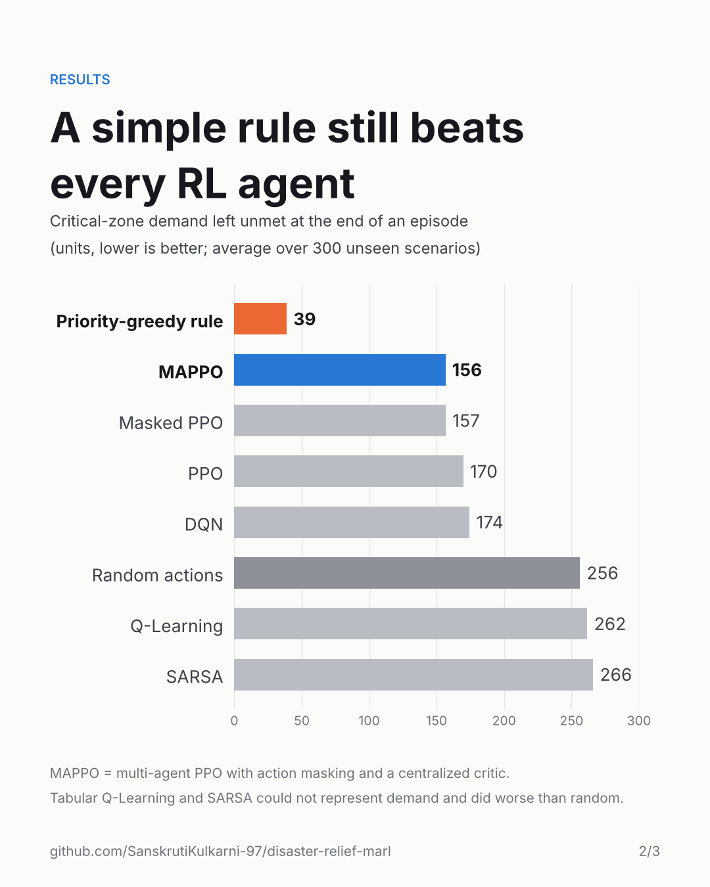

# AI Disaster Relief Supply Chain Optimization

**Multi-agent reinforcement learning for disaster-relief logistics.** Three warehouses
dispatch water, food and medicine to five disaster zones under growing demand, roads
that fail mid-episode, limited trucks and humanitarian priority levels. Six RL
algorithms are compared on the same environment, reward and training budget
(3 seeds each, evaluated on 300 unseen scenarios).

<p align="center">
  
  
</p>

## Key findings

- **MAPPO is the best learned policy**: it leaves 39% less critical-zone demand unmet than random dispatching.
- **Action masking matters most**: blocking impossible actions made PPO reach the reward threshold 5.5× sooner and improved its final reward from −31.5 to −19.3.
- **The centralized critic adds stability**: MAPPO matches masked PPO's final score with a 7× smaller spread across seeds and learns about twice as fast.
- **Tabular Q-Learning and SARSA do worse than random**: their discretized state cannot represent demand.
- **A simple rule still wins**: "serve critical zones first" beats every RL agent, a reminder to always benchmark against a strong heuristic.
- **Debugging story**: the first MAPPO version learned nothing because the actor and critic shared one gradient clip. The critic's gradients were ~160× larger, which shrank policy updates ~470×. Separate optimizers and value normalization fixed it.

## Results

| Method | Unmet critical demand ↓ | Episode reward ↑ | Episodes to reach −50 reward ↓ |
|---|---|---|---|
| Priority-greedy rule (hand-written baseline) | 38.8 | 43.1 | – |
| **MAPPO** (masked, centralized critic) | 156.5 ± 2.3 | −17.9 ± 0.7 | 195 |
| Action-masked PPO | 156.7 ± 9.3 | −19.3 ± 5.4 | 419 |
| PPO | 169.7 ± 7.9 | −31.5 ± 5.3 | 2315 |
| DQN | 174.4 ± 18.9 | −46.2 ± 12.6 | 3109 |
| Random feasible actions | 256.2 | −70.3 | – |
| Q-Learning | 261.7 ± 4.2 | −218.1 ± 12.6 | not reached |
| SARSA | 266.0 ± 2.7 | −223.3 ± 3.5 | not reached |

Learned policies: mean ± std across 3 training seeds. Policy-gradient methods are evaluated by sampling from the policy, DQN and the tabular methods greedily.

## Environment

| | |
|---|---|
| Agents | 3 warehouses (shared policy, each acts on its own local view) |
| Zones | 5, each with priority critical / high / normal |
| Commodities | water, food, medicine |
| Actions | 31 per agent: commodity × zone × quantity (30 or 60), or wait |
| Uncertainty | Poisson demand growth every step, random permanent road failures |
| Reward | priority-weighted delivery − transport cost − penalty on unmet critical demand |

## Setup (VS Code, Windows / macOS / Linux)

1. Open this folder in VS Code (**File > Open Folder**).
2. Create a virtual environment and install the requirements in the VS Code terminal:

   Windows (PowerShell):
   ```powershell
   python -m venv .venv
   .venv\Scripts\Activate.ps1
   pip install -r requirements.txt
   ```
   macOS / Linux:
   ```bash
   python3 -m venv .venv
   source .venv/bin/activate
   pip install -r requirements.txt
   ```
3. Select the interpreter: **Ctrl+Shift+P > Python: Select Interpreter > .venv**.

## Run

Use the **Run and Debug** panel (Ctrl+Shift+D) and pick one of the three
configurations, or run the same commands in the terminal:

| What | Command | Time |
|---|---|---|
| Rebuild evaluation, figures and report from the included trained runs | `python run_all.py --skip-training` | ~1 min |
| Quick smoke test of the whole pipeline (300 episodes, 1 seed, written to `outputs_quick/`) | `python run_all.py --quick` | ~1-3 min |
| Full experiment from scratch (7 methods x 3 seeds x 4000 episodes) | `python run_all.py` | ~30-60 min, depends on CPU cores |

The full run overwrites `outputs/` and `report/`. Use `--jobs N` to set how
many training runs execute in parallel (default: CPU cores minus one).

## Files

| File | Purpose |
|---|---|
| `disaster_env.py` | The simulator: warehouses, zones, demand, roads, vehicles, reward, action masks |
| `train_mappo.py` | Original MAPPO implementation (kept unchanged; it does not learn, see report Section V) |
| `train_mappo_v2.py` | MAPPO with the corrected update (separate optimizers, value normalization, 8 episodes per update) |
| `compare_algos.py` | Q-Learning, SARSA, DQN, PPO and action-masked PPO, e.g. `python compare_algos.py --algo dqn --seed 42` |
| `evaluate_all.py` | Evaluates baselines and all trained policies on 300 held-out scenarios, writes `final_results.json` |
| `make_figures.py` | Learning-curve figures for the report |
| `fill_report.py` | Fills every number in `report/report_template.tex` from `final_results.json` |
| `run_all.py` | Runs all of the above in order |
| `outputs/` | Trained runs (training CSV, model, evaluation) for every method and seed, plus `final_results.json` |
| `report/` | `final_report.tex` (paste into Overleaf), its template, and the figures |

## Using the report in Overleaf

Upload `report/final_report.tex`, `report/fig_comparison.pdf` and
`report/fig_learning_curves.pdf`. The architecture and flow diagrams are
referenced as `architecture.png` and `flowchart.png`; upload your existing
diagram images under those names.

## Notes

- Evaluation scenarios use seeds 900000-900299, disjoint from all training scenarios.
- Results vary slightly between machines and PyTorch versions; the conclusions should not.
- `fill_report.py` prints a WARNING if regenerated numbers no longer match a statement in the report text.
  The quick test always prints such warnings: 300 episodes is too short for the agents to learn, so it only checks that everything runs.
